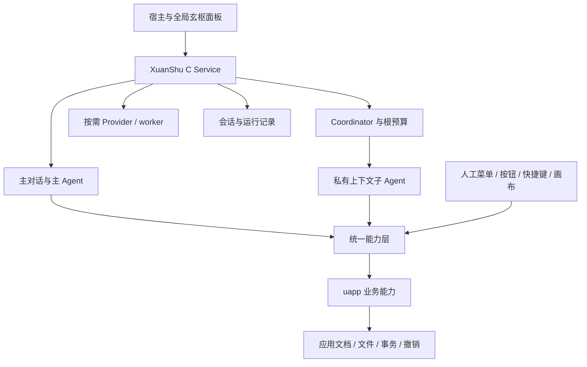

> 2026-10-26最新状态：本轮先冻结[P4A-1](xuanshu-p4-controlled-edit-contract.md)，已完成P3租约收口及P4-A单资源夹具实现；Native44/44、Light49/49、ASAN44/44，限定为**P4-A开发阶段模拟及自动验收通过**。见[P3独立复审](validation/xuanshu-p3-independent-review.md)、[本轮验收/身份/首次失败](validation/xuanshu-p4a-validation.md)。整体架构仍Proposed，P4-B/C、正式面板、应用接入和真实人工均未完成；下文历史状态保留。

# XuanShu 原生 AI 子系统集成设计

> 最新阶段：2026-10-24 P3已获授权并完成本文范围的开发阶段模拟/自动验收。原主对话、恢复和生命周期方向不变；精确独立接口/预算/存储合同转到[P3-1](xuanshu-p3-service-contract.md)，证据与首次失败见[P3验收](validation/xuanshu-p3-validation.md)。历史章节的“P3仅规划/未授权”是当时状态，不再描述当前交付；整体Proposed及P4—P6未实现边界保留。

状态：Proposed（整体）。设计版本：1。日期：2026-10-22。读者：框架及应用开发者。P0/P1基线及后续整体规划；A+B只读子集见第9节，C1授权实现及后续边界见第10节。

依据：[双工程审计](xuanshu-native-code-audit.md)、[应用能力合同](application-capability-contract.md)、[当前开发标准](application-development-standard.md)、[版本政策](version-policy.md)。本文中的新接口、状态和默认值均为本次建议；原有实现与缺口以审计表F/X编号为准。

## 1. 决策、候选方案与架构

### 1.1 已确认的产品决定

宿主统一拥有原生C AI服务；应用提供业务能力及可选Agent配置。每个宿主只有一条主对话，跨应用切换保留对话。独立新任务排队，取消、审批、补充信息即时路由。主Agent直接处理简单调用，复杂任务交给Coordinator和私有上下文子Agent。

服务常驻，网络连接和执行worker按需启动。面板默认收起，收起不取消任务。重启恢复历史与任务记录，核对目标和未知结果后由用户明确继续；不自动恢复执行。普通可撤销编辑按已确认任务授权执行，破坏性、外发和不可撤销行为逐次审批。

首个试点为stateful_components，最小EDA补充画布语义。未来P2同时迁移五个维护示例包，业务应用和内置浏览器后续逐项迁移。原生移植按阶段交付必要合同，不承诺一次覆盖XuanShu全部TS功能。

### 1.2 候选方案与取舍

| 方案 | 结论 | 理由 |
| --- | --- | --- |
| 原生C服务直接集成 | 本案选择 | 符合宿主统一管理、C调用与单对话目标；需要重做TS运行时行为 |
| 嵌入Node或外部TS服务 | 本案不采用 | 会引入第二运行时及进程/IPC部署边界，不能称原生C内核 |
| 每uapp各自模型与Agent | 本案不采用 | 对话、权限、预算、连接和卸载责任分裂 |
| 仅调用现有Assistant命令 | 保留迁移适配，不作为完整目标 | 双重注册、Schema及资源绑定不完整，且没有服务/Coordinator |
| 按XuanShu全量行为对等重写 | 不设为本轮目标 | 先移植必要合同；未移植项明确列出，避免把缺少的Runtime/Storage接入带入C |

### 1.3 组件与所有权



C服务实现放入框架内部模块，与当前C11及Windows x64工具链一致；宿主创建每工作区一份service对象，应用只能注册能力/角色配置，不能创建第二个全局模型服务。静态嵌入模式由嵌入宿主显式创建，不能在DllMain/query/create静态初始化时启动网络。

UI线程拥有workspace、目录、目标绑定、审批入口、应用回调和结果投影。服务控制器拥有对话、任务、运行状态、预算和worker生命周期；应用拥有业务文档及事务；存储worker拥有数据库连接。主Agent和子Agent是服务中的执行对象，不是uapp自建线程或可卸载回调。

模型/Coordinator不能访问host、component、文档裸指针或应用函数表。能力层在UI线程解析稳定ID和存活代次，取得模块租约后才调用应用。服务可复用现有workspace加载/关闭路径，但不能把ui_assistant_t当成模型执行器。

## 2. 主对话、上下文与 Agent 配置

### 2.1 对话与任务身份

conversation_id标识可恢复主对话；host_epoch标识本次进程寿命；root_run_id标识一次用户独立任务；子run另有parent_run_id。显示在一条对话中不代表所有任务共用一份可变执行上下文。

用户新消息先分类为关联控制或独立任务。审批/问题回复必须带对应ID和nonce；不确定关联时在主对话要求澄清，不把自由文本默认为批准。补充信息只交给对应任务并记录版本；新独立任务进入最多16项的队列，超限拒绝接纳且保留用户输入。一次只运行一个根任务，根内子任务可并发。

任务提交时从可信UI选择及能力发现结果固定目标集合；没有明确目标时先澄清。活动标签只是建议默认值。后续步骤新增目标/范围须经相同绑定和授权流程，不能静默扩张既有任务。根任务完成后才能启动下一独立任务；因未知修改而隔离的资源继续禁止AI写入。

跨宿主进程各有独立conversation/service。恢复时只能独占认领未被其他进程使用的conversation；已被占用则创建新的对话，不能共享一个writer或自动合并。既有应用文档/宿主标签没有自动重开的承诺。

### 2.2 上下文构造

主Agent从用户消息、获准目标摘要、按需工具目录和已确认步骤结果构造输入。应用snapshot、网页、文件内容和工具结果都是数据，不得提升为可信系统政策。应用Agent提示只定义专业角色，不授予权限或覆盖宿主政策。

子Agent初始只得到任务说明、显式资源scope、相关能力ID/Schema、必要数据引用及自己的限制；不复制完整主对话、其他应用snapshot、密钥或兄弟私有记录。模型输入转换完成后记录精确可见输入的manifest/hash，再派发Provider；token估算与Provider实际usage分开。

子Agent补充信息以question_id、parent/root、问题、允许公开的上下文摘要进入Coordinator收件箱，再由主Agent在主对话提问。答案只交给对应子任务。结果也先交Coordinator，主Agent汇总后回复；审批始终由宿主显示和消费，不委托模型批准。

任务预算同时约束模型调用、工具调用、步骤、上下文字节、输出token预留、深度及子任务数。Provider未报告usage时保留unknown，不计成0或据此追加预算。不能沿用context模块32K字符截断并宣称获得精确token上限。

### 2.3 Proposed 应用 Agent 配置

应用在create内注册纯数据配置，框架深复制。没有配置时主Agent仍可使用应用能力，不强制每应用创建常驻子Agent。

```c
typedef struct ui_ai_agent_profile {
    uint32_t size, version;
    const char *id, *name_utf8, *description_utf8;
    const char *instructions_utf8;
    const char *allowed_capability_ids_json;
    const char *input_schema_json, *result_schema_json;
    const char *requested_scopes_json;
    uint32_t max_steps, max_model_calls, max_tool_calls;
    uint32_t max_children, max_depth;
} ui_ai_agent_profile_t;

ui_status_t ui_ai_register_agent_profile(
    const ui_app_context_t *, const ui_ai_agent_profile_t *);
```

配置version=1，必须完整size；ID在app命名空间内稳定，单项复制预算64KiB，每实例最多8项，总预算256KiB。instructions和各Schema分别不超过16KiB。allowed_capability_ids只能选择本实例或明确授权的宿主通用能力；实际scope和预算是应用请求、用户授权、根任务余量、宿主限制的交集。不能声明自己的Provider连接、凭据或审批回调。

子Agent按Coordinator需要创建，未获授权的角色配置不进入模型输入。模块开始注销后不能spawn新的相关子任务；已复制的角色文本可保留作记录，但应用能力租约未释放前不得卸载。

## 3. 状态机、预算与执行合同

### 3.1 服务和任务状态

| 对象 | 状态与转换 |
| --- | --- |
| Service | CREATED→OPENING→READY；READY可接任务；失败进入UNAVAILABLE；关闭进入QUIESCING→DRAINING→CLOSED。QUIESCING封闭接纳，不表示worker已退出 |
| Root/child run | QUEUED→RUNNING；可进入WAITING_INPUT、WAITING_APPROVAL、WAITING_DEPENDENCY，再回RUNNING；取消进入CANCEL_REQUESTED，超时未退出标CANCELLATION_STALLED；真实执行者退出后DRAINING→FINISHED |
| Run outcome | 只在FINISHED选择一次completed、failed、cancelled、timed_out、limit_reached或unknown；取消请求与终态分开 |
| Capability call | ACCEPTED→VALIDATING→WAITING_APPROVAL/WAITING_WRITE_GATE→DISPATCHING→RUNNING→RECORDING→FINISHED；拒绝可在未派发时结束。status/effect沿能力合同独立表达 |
| Approval | PENDING→APPROVED或DENIED/EXPIRED/INVALIDATED；APPROVED→CONSUMED单次。条件变化不得把CONSUMED票据重新变为PENDING |
| Child lifecycle | RESERVED→QUEUED→RUNNING/WAITING→OUTCOME_OBSERVED→COLLECTED；失败spawn也必须结算预留并留下记录 |

状态投影可以重复通知，权威事件不能重复推进。等待UI重绘、空消息队列、idle paint0、模型已输出最后一个token都不等于任务FINISHED。不得忽略仍在修改应用状态的异步执行者来提前终结根任务。

取消/超时若发生在业务提交之后，保留实际applied结果，再停止后续步骤；提交前可停止则effect=none。已派发但结果不明优先进入unknown及核对，不能用cancelled覆盖。只有所有执行者和回调退出，才允许确定最终run outcome；存储确认不明则结果标durability=unconfirmed并保留核对材料。

### 3.2 共享预算和 Coordinator

P3主Agent直接调用工具也使用根预算；P5所有子Agent接入同一RootControlLedger，不再各建调度器。模型/工具派发和子admission先原子预留，再执行；超额在副作用前拒绝。重复operation_id同请求重放返回原预留，不重复扣费；同ID不同内容拒绝。失败spawn保留agent-call预留，不悄悄退款后循环重试。

建议v1默认：根步骤64、模型调用16、工具调用64；每次模型或工具实际派发各扣一个step及对应call，admission另扣agent-call，重复预留不重复扣数。每次模型输入预算32K token估算及128KiB字节双限，输出最多4096 token；Provider适配器不能保证token预留时拒绝开始该次请求。模型真实usage另计，不据其缺失放宽限额。用户/宿主可下调，提升需重新确认任务预算。

P5结构上限沿已审阅动态内核的有界方向：并发4、深度3、直接子8、后代32、排队16。根调度和预算预留串行；不同文档可并发，同文档写入经统一写门串行。等待子结果、审批和依赖不占worker线程；等待状态不产生额外模型轮询。

5秒取消停滞仅产生CANCELLATION_STALLED事件和UI提示，继续等待真实join；它不是强杀或假终态时限。某子失败阻止依赖任务，独立任务是否继续由已提交计划的fail-fast=false默认规则决定；根取消则传播到全部后代。结果收集、预算记录及模块引用都完成后才COLLECTED。

### 3.3 能力执行与审批

所有执行遵守 [能力合同](application-capability-contract.md) 的资源身份、参数校验、审批和单资源写入合同。任务的授权不是任意工具永久许可；参数、目标、scope和版本都必须落入任务授权范围。子Agent只获得该范围的交集，不能继承全部权限。

目录摘要、模型选择、参数校验、业务check、审批和派发分开。未迁移应用的旧Assistant没有完整输出/版本合同，默认只开放可验证读取；没有validator、正确的document/resource revision或事务回执时，不开放AI写入。

应用begin/commit/rollback/undo由UI线程调用，框架只管理顺序和结果。一次写入门覆盖异步业务操作，人工编辑也参与同资源序列。普通可撤销编辑允许按任务授权执行，但P4之前服务只读；不能凭旧assistant max_permission=EDIT绕过阶段门槛。

跨应用任务记录每一步before/after revision、operation_id及实际effect。应用A提交、应用B失败时，展示部分完成；补偿是新的显式授权步骤，不预设跨应用原子事务或自动undo。事务隔离失败、输出Schema错误、存储确认不明和网络取消后未知结果都要阻止相关资源下一次写入。

## 4. C 接口、线程及复制消息

### 4.1 Proposed 宿主服务接口

以下建议声明属于未来独立宿主接口 `ai_service.h`。不写入现有public header，不允许uapp自行创建全局服务；类型依赖能力合同中的target。所有config结构完整size/version=1，字符串输入返回前复制。

```c
typedef struct ui_ai_service ui_ai_service_t;

typedef struct ui_ai_event {
    uint32_t size, version;
    const char *conversation_id, *root_run_id, *run_id;
    const char *event_id, *type;
    uint64_t sequence;
    const char *payload_json;
} ui_ai_event_t;
typedef void (*ui_ai_event_fn)(const ui_ai_event_t *, void *user_data);

typedef struct ui_ai_service_config {
    uint32_t size, version;
    ui_workspace_t *workspace;
    const char *conversation_id;
    const char *user_state_directory_utf8;
    const char *model_profile_id;
    ui_ai_event_fn on_event;
    void *user_data;
} ui_ai_service_config_t;

typedef struct ui_ai_task_request {
    uint32_t size, version;
    const char *client_request_id;
    const char *input_utf8;
    const ui_cap_target_t *targets;
    size_t target_count;
} ui_ai_task_request_t;

ui_status_t ui_ai_service_create(
    const ui_ai_service_config_t *, ui_ai_service_t **out_service);
ui_status_t ui_ai_service_open(ui_ai_service_t *);
ui_status_t ui_ai_submit(ui_ai_service_t *, const ui_ai_task_request_t *);
ui_status_t ui_ai_cancel(ui_ai_service_t *, const char *root_run_id);
ui_status_t ui_ai_answer(ui_ai_service_t *, const char *question_id,
    const char *answer_utf8);
ui_status_t ui_ai_decide(ui_ai_service_t *, const char *approval_id,
    const char *binding_hash, int approved);
ui_status_t ui_ai_reconcile(ui_ai_service_t *, const char *operation_id);
ui_status_t ui_ai_continue(ui_ai_service_t *, const char *root_run_id);
ui_status_t ui_ai_poll(ui_ai_service_t *, uint32_t max_messages);
ui_status_t ui_ai_service_request_close(ui_ai_service_t *);
ui_status_t ui_ai_service_destroy(ui_ai_service_t *);
```

create只分配UI控制对象，不联网或读磁盘；open异步恢复存储后发READY/UNAVAILABLE事件。READY之前submit返回UI_STATUS_CANCELLED，明确没有接纳；调用方保留输入。submit返回OK仅表示接纳，接受事件包含root_run_id/client_request_id。client_request_id由宿主预建，用于同步accept回调早于submit返回时的关联；重复同内容返回既有任务，不重复执行，同ID不同内容拒绝。

输入最多16KiB、每任务最多16个target，目标字段限制沿能力合同，超限不部分接纳。answer最多16KiB；approval_id/binding_hash必须对应宿主当前审批记录，不能接受模型消息构造的批准。continue仅在明确UI操作后调用，并重新绑定当前存活目标；历史target中的旧host_epoch/instance_id不能直接复用。

poll每次1..256条，UI事件payload借用到callback返回，需保留时复制；不能在回调内destroy服务、workspace或模块。request_close幂等地请求收尾；destroy仅在CLOSED且无回调/worker引用时成功，否则返回UI_STATUS_CANCELLED并保持对象有效。应用不直接获得该service指针。

### 4.2 Provider 和存储边界

Provider是框架内部C函数表，v1只有stub实现进入P3。建议最小合同如下，函数表只由宿主装配，不由应用注册网络执行引擎：

```c
typedef struct xs_provider_job xs_provider_job_t;
typedef ui_status_t (*xs_provider_emit_fn)(
    const char *kind, const void *bytes, size_t count, void *sink);
typedef struct xs_provider_ops {
    uint32_t size, version;
    ui_status_t (*run)(xs_provider_job_t *, xs_provider_emit_fn, void *sink);
    void (*request_cancel)(xs_provider_job_t *);
    void (*dispose)(xs_provider_job_t *);
} xs_provider_ops_t;
```

run在worker线程执行，一次job独占自己的连接/解析状态；emit复制字节到服务队列，不能直接回调UI。request_cancel必须可跨线程并发、非阻塞且幂等；dispose仅run实际返回且emit全部退出后在worker清理阶段调用。job内容为不可变请求及取消状态，不含host或应用指针。取消停滞不释放job、buffer或连接对象。

模型适配先核对tool/stream/structured-output支持，不能虚构厂商能力；流片段只作展示，完整工具调用聚合并校验后才交能力层。半个JSON、断流或重复tool_call_id不派发业务。P3用确定性stub覆盖流、错误、取消及不服从取消的job；真实HTTP适配不在本轮或P3默认授权内。

存储在单writer worker上串行，接口需提供open/load、append_batch(expected_head, owner_generation, operation_id)、reconcile_write(operation_id)、save_checkpoint、query_events和flush/close。append_batch返回明确committed/not_committed/unknown和精确event head；超时不能直接重试业务。P3先实现最小会话/事件持久化，P4补业务意图和审批原子消费；不链接TS SqliteRunStore或读取原XuanShu数据库。

### 4.3 消息与所有权

| 内容 | 所有者及有效期 |
| --- | --- |
| workspace、host、component、应用文档及callbacks | UI线程/原模块拥有；worker不得读取或以scope保活 |
| Provider输入与输出buffer | job拥有；emit返回前复制，服务不留生产者借用地址 |
| 能力注册描述 | 框架复制纯数据/函数表；模块租约保证函数与user_data到最后回调退出 |
| UI投影事件及result字符串 | callback期间借用；消费者复制；UI失败不改变权威终态 |
| 主/子上下文 | 服务拥有不可变快照；子Agent只得到显式projection |
| 凭据明文 | 仅Provider job的短命buffer；使用后清零；不进事件/上下文/普通日志 |
| 异步应用完成 | workspace+instance ID复制app_data；UI找call_id后完成，不能worker直调complete |

UI→worker消息在提交时复制目标、参数、catalog generation、request/run ID；worker→UI带host_epoch、instance/open epoch、run/call ID、消息序号及纯数据。全局AI队列最多1024项和8MiB，包含其中为关闭/取消/完成预留的64项及64KiB；普通消息最多960项及8MiB减64KiB，不能消耗控制预留。单条最多256KiB，入队预算包含复制载荷、元数据和队列节点；控制载荷沿事件16KiB上限。应用目录/上下文预算另计，不能挤占既有8MiB组件队列。

流式文本可按run合并，UI只读展示可丢中间投影；不能丢审批、业务完成或权威事件。满队列返回LIMIT_EXCEEDED给生产者，通过可取消wait重试enqueue或停止job，UI线程不得阻塞等待空间。控制完成消息也暂时无法入队时，完成记录保留在job状态并唤醒UI重取，worker不能在未被接管前销毁它。未知/旧代次数据不调用应用，产生拒绝记录后释放复制体。

旧workspace.post_copy没有统一预算，不能把AI流直接无限post_progress。可借用WAKE/poll机制，新增有界服务队列及UI派发，不改当前消息预算或提高旧阈值。因post被接纳不代表已完成业务处理，使用ACK/完成记录关联；重复消息不重复写入。

## 5. 生命周期与故障边界

### 5.1 应用关闭及注销

关闭目标实例先封闭新能力调用/子任务，取消未派发调用和待审批票据，通知运行任务协作停止。已进入业务提交的操作按实际effect收尾，必要时核对；不要仅从cancel flag推断完成。

应用request_close仍可REFUSE/WAIT。WAIT期间UI继续poll、接收现有任务完成、释放回调租约并等待worker；不能在UI线程join还依赖UI回调的线程。只有全部在途调用/外部回调退出、投递已处理或安全丢弃，才允许ALLOW并finish_unregistration，随后沿既有unmount/destroy/module_shutdown路径卸载。

模块级注册可服务多个实例，必须等最后一个实例及AI租约归零。清理失败保留DLL和有效workspace，报告具体阻塞任务；不提高超时、不强杀或声称成功卸载。未知业务结果阻止AI后续写入，但若执行者确已退出，可独立完成应用关闭并保留待核对运行记录；不能让记录保存悬空callback。

### 5.2 宿主退出

1. Service进入QUIESCING，拒绝新任务；保存关闭意图，取消排队/运行Agent及Provider，禁止新的应用写入派发。
2. 请求workspace关闭应用，继续UI消息循环及服务poll，处理WAIT和回调收尾。应用REFUSE时撤回退出意图；已经取消的任务不自动复活，等服务状态安全后可接新的明确任务。
3. 所有应用能力调用和模块引用退出后，确认Provider job真正返回、存储flush完成、事件ACK已处理；服务进入CLOSED。
4. destroy service，再销毁workspace和宿主窗口。任何一步未完成，保持DRAINING和可诊断状态，不能先释放workspace再让worker继续post。

系统崩溃/强制结束无法承诺此顺序，交给下次启动的意图/结果核对。方案不修改Windows服务、用户会话或未知进程。

### 5.3 同进程故障边界

uapp与服务共享地址空间。结构校验、scope、队列与回调租约只防合作代码的误用和越权路径，不防任意C内存写、死锁、异常及原生库崩溃。应用崩溃可能带走整个宿主；不以SEH包围回调承诺恢复一致文档，也不强制结束单线程后继续进程。若需要不可信应用或Provider的硬隔离，应另立进程/IPC方案并重新评审。

## 6. 配置、持久事件与恢复

### 6.1 用户级配置与凭据

建议用户目录 `%LOCALAPPDATA%\UiFramework\XuanShu`。`config-v1.json` 保存模型profile ID、endpoint、model、协议能力及credential_ref，禁止保存apiKey。Windows凭据管理器由服务内部凭据适配访问；应用不读凭据，Provider job按需取出并短命持有。仅参考现有XuanShu CLI配置形状，不沿用其文件apiKey字段。

profile ID绑定非秘密配置revision。任务创建时固定profile revision；普通配置切换只影响新任务，不静默替换在途模型。撤销凭据/禁用profile立即停止新网络请求并取消相关job；当前已发送请求是否完成须按实记录。错误、UI日志、模型输入、hash前描述和产物不能含凭据；同进程内不宣称秘密无法被恶意模块读取。

每conversation一个独占数据库文件，使用持久conversation UUID命名；多宿主不共享同一writer。建议原生SQLite C后端，WAL+FULL同步、独立schema_version=1及显式迁移事务；不是XuanShu schema5或计划schema6的二进制兼容实现。P3开工前须锁定原生依赖源码版本、许可证、构建方式和离线供应；本轮不下载、不选写SDK、不新增构建依赖。

### 6.2 持久性与事件顺序

会话表保存用户/助手可见消息；run/call表保存状态及目标；events表保存权威事件；approvals保存精确绑定及消费；intents保存可能有副作用的派发意图。应用业务文档不存入AI库。业务产物单独引用，按授权寿命访问，删除记录不能隐式删除应用文件。

每run sequence严格递增、每库storage_order记录跨run入库顺序；并行子Agent事件不存在额外天然全局因果顺序，因果关系靠parent、dependency和operation ID。owner_generation和expected_head在同一数据库事务内检查，事件与状态更新、审批消费及根预算预留需要各自原子提交。

权威事件payload最多16KiB、单字符串1KiB、数组32项，保存ID/hash/摘要；完整对话、流式展示和授权产物另存，不能把完整主/子transcript广播到事件流。主UI根据已确认事件投影，UI回调异常仅影响显示，不改变权威终态。对话正文落盘失败不能静默当已保存。

事件写入必须有operation_id、请求hash和明确回执；同ID同内容幂等，相同ID不同内容拒绝。磁盘满/锁错误在副作用前停止派发，已派发后失败则保留不确定状态。表内唯一约束保证每run一个terminal事件；先确认terminal再清理checkpoint，不能删除唯一恢复依据后补写终态。

业务文档与AI库不是一个事务：先持久化dispatch intent，UI检查仍有效后调用应用，应用返回带operation_id的结果，再持久化completion。期间崩溃存在“已经修改但结果未确认”的窗口。只有应用明确支持同operation_id的业务去重/核对时，才能据其回执继续；一般调用不承诺exactly-once，也不能盲目重试。

### 6.3 重启与核对

启动只恢复消息、事件head、待审批及未完记录，全部未完成run进入NEEDS_RECONCILIATION投影；它不是自动执行状态。host_epoch重新生成，旧instance ID和open_epoch全部失效。用户明确继续后重新选择/识别应用和资源、核对revision，再为新执行段建立绑定；旧审批不自动沿用。

未派发intent可明确标not_dispatched；存在dispatch但无可信结果则调用应用只读reconcile(operation_id)或回读固定资源。可确认applied/not_applied才继续，否则保留unknown及资源写隔离，向用户展示部分完成。记录损坏、未来schema、owner冲突或迁移失败时拒绝写入并保留原库，不删除库或自动创建新库冒充恢复成功。

P3用stub及故障注入建立最小会话/事件可靠性，P4建立写入前意图和结果核对；P6才扩大长期存储、故障窗口和资源验证。任何一次阶段通过不能代替后续长时间运行与物理环境验收。

## 7. 阶段、依赖、验收与停止条件

| 阶段 | 范围及依赖 | 必须验收 | 停止条件 |
| --- | --- | --- | --- |
| P0 | 双工程基线、源码链、复用映射、试点完整清单 | 每项有源码/规划/建议分类；测试存在与运行结果分开 | 参考源码不可取得就标缺失，不造结论 |
| P1 | 本案三份Proposed文档、C合同、状态/线程/所有权、迁移矩阵 | 设计交叉一致，未决项注明阻塞阶段 | 停在设计评审，不实现 |
| P2 | 接受协议和版本决议后，实现统一目录、UI绑定、目标revision；五个示例同时迁移 | AC01—AC10/12/14/16；人工与能力调用真实业务回读一致；只读/参数/关闭边界 | edit只计数、草稿冒充保存、功能漏项、双注册漂移均不得进入P3 |
| P3 | P2后，常驻C服务、单对话、stub Provider、只读工具、流式/取消及最小会话事件存储 | 面板收起任务继续；目标固定；同步回调、满队列、取消停滞、重启只恢复记录、关闭不悬空 | Provider非stub、AI写入、假终态、未join卸载或记录丢失即停止 |
| P4 | P3后，用户任务授权、精确审批、版本/单资源写门、应用真实事务/undo、intent/reconcile | AC13/15；审批重放/条件变化拒绝；取消后实际效果；每个崩溃窗口可核对或显式unknown | 没有可核对写入结果、只有UI变化、假rollback、未知结果自动重试均停止 |
| P5 | P4后，Coordinator、应用级子Agent、跨应用步骤；browser/其他应用按矩阵迁移 | 私有上下文、权限交集、共享预算、并发上限、失败spawn、后代取消/collect、跨应用部分失败 | 兄弟/主对话泄露、二次调度权威、越权、预算重复预留或子任务未收集即停止 |
| P6 | 前阶段后，持久化完善、故障核对、资源与长期卸载 | 独立进程重启/磁盘满/断流/损坏/锁；真实DLL卸载、资源曲线、长时运行 | 失败保留最小诊断；不提高阈值、强杀或替换旧材料为通过 |

每一阶段只在用户明确指定后开展；设计评审通过不自动授权Provider、业务应用改动、benchmark、recovery、release、tag或远程工作流。P2不接入真实模型，P3默认仅stub。既有框架/浏览器及Mesa/Runtime未闭环事项独立保留，不纳入本案成功口径。

### 7.1 未来验收矩阵

| 编号 | 场景 | 核心断言 |
| --- | --- | --- |
| XS01 | 两实例切标签、改标题、关重开资源 | task/call仍指原资源；旧epoch拒绝，无自动重定向 |
| XS02 | Schema错误、旧目录、disabled/busy/modal及业务只读 | 在副作用前拒绝；来源字段不能提权 |
| XS03 | 人工与AI并发写、审批后人工修改 | 相同资源串行；expected_revision冲突；新审批不复用旧票据 |
| XS04 | 同步handler完成早于submit返回、重复/乱序完成 | 预先关联，无悬空记录、一次业务效果和一次终态 |
| XS05 | draft修改、取消、submit失败与成功回读 | 草稿不改文档；失败保留；业务成功后按提交快照选择性确认，不接受无关草稿 |
| XS06 | 流式半JSON、断流、满队列、慢UI、control槽满 | 不派发未完成工具；预算不超限；终态不丢、取消不饿死 |
| XS07 | Provider/应用忽略取消、5秒后返回、取消前已提交 | 停滞非终态；保留实际effect；不先dispose/FreeLibrary |
| XS08 | 排队/审批/运行时关实例及宿主，应用REFUSE/WAIT | UI继续收尾，拒绝可撤回退出；所有回调出栈后卸载 |
| XS09 | 存储拒绝/回执丢失/intent后崩溃/completion前崩溃 | 无未知副作用重试；同operation幂等核对；明确unknown |
| XS10 | 子Agent越权、私有记录、失败spawn及取消后collect | scope交集；根预算只记一次；不会广播完整主对话 |
| XS11 | 重启、损坏/未来库、被其他宿主认领、profile禁用 | 不自动执行；旧审批/目标失效；原库保留，凭据不落日志 |
| XS12 | A成功B失败、rollback/undo不支持或失败 | 记录部分结果与资源隔离；没有跨应用原子事务承诺 |

以上为未来验收规格，不是本轮测试结果；旧ASAN、Runtime及浏览器通过记录不填写到XS/AC编号下。

## 8. Proposed 决议、未决项与交付边界

| 编号 | 本案建议 | 需要的评审/阻塞阶段 |
| --- | --- | --- |
| D01 | 已确认：SDK0.10-dev/API10/标准10，ABI1/包1和既有公开布局保持 | A+B同步当前元数据；不预先导出AI Service |
| D02 | 已确认：后续示例内存业务状态/revision/回读，不新增文档格式 | UI/示例迁移不在A+B；事务/undo为P4 |
| D03 | 已确认方向：原生SQLite C和Windows凭据引用 | P3前另审版本、离线供应和实现；P2无依赖 |
| D04 | 已确认：最小Schema、yyjson0.13.0固定源码、RFC8785/JCS+SHA256及P2限额 | 组合/引用拒绝；Agent预算与root/child并发数值仍属建议 |
| D05 | 已确认：同进程合作边界，硬隔离另案 | 不承诺恶意模块或原生崩溃隔离；真实Provider未授权 |

草稿冲突另已确认保留草稿并标记冲突，提交显式解决；不在A+B实现。首批细节以[能力合同第4节](application-capability-contract.md#4-api10-首批只读-c-接口)和公共头文件为准；后续AI Service/Provider声明仅为文档草图，不是已存在公共接口。

相对最初草案，主要细化为：按阶段行为移植；单宿主单主对话且新根任务排队；重启显式继续；维护示例P2整体迁移；P3前置最小持久记录、P4前置业务核对；补非文档resource revision、输出未知效果、有界队列和两阶段注销。它们直接对应本次源码缺口，不扩展到业务算法或新应用功能。

建议第一个实现范围是P2的统一目录/校验/目标绑定和五个示例迁移，以stateful最小真实状态回读与EDA现有操作一致性为主验收；届时仍不含模型网络或AI写入。当前仅A+B获得实施授权，停止位置是其代码评审；完整P2及P3—P6未授权。

## 9. A批+B批当前实现与边界

源码已实现：宿主内只读能力目录、分类分页、资源枚举/显式绑定、prepare/dispatch、稳定ID完成、结果查询释放、协作取消及注销/关闭引用门（含WAIT后REFUSE恢复接纳）。解析库锁为yyjson0.13.0 commit `6447536015f3d600f3d65323b10976103b337ca7`，[源码与许可证锁](../third_party/yyjson/source-lock.json)逐文件SHA256由CMake离线核对。JCS替换旧capcanon-v1。当前引用门不接管应用任意线程句柄；应用在worker和外部回调真实退出后才complete，不能把投递消息当作线程已退出。

与P1接口草图的差异：首批接口使用应用host而非扩充app_context；静态调用方可共用核心，workspace负责实例身份和关闭门；无裸call寿命，完成靠稳定ID；本轮只提供查询结果，无模块订阅回调；仅read效果和固定read scope，不预做写门/ACL/审批。发现是元数据快照，业务可用性在dispatch权威检查。这些是为最小可验证闭环缩小范围，并非完整P2完成。

本轮不引入AI Service、UI绑定、真实业务模型、五示例能力迁移、Provider、SQLite、凭据或恢复。A+B验证独立见[本轮验收](validation/xuanshu-p2ab-validation.md)。新旧测试结果必须分账；历史Mesa/Runtime问题沿交接保留。

评审收口已落实最后一次应用回调返回后的执行门复查，不禁止回调重入，也不新增状态或公共结构。真实DLL测试验证应用自行确认worker及受控回调线程退出后才complete；同步完成不释放仍在execute栈上使用的对象，复制队列背压也不伪造终态。该证据只覆盖测试适配，不能外推为框架自动追踪任意线程或所有第三方回调；[独立新结果与未定位失败](validation/xuanshu-p2ab-validation.md#7-2026-10-22评审收口独立新证据)保留。

## 10. C1已实现的入口与后续边界

本节承接已确认的剩余P2决策，仅C1获实施授权。保持SDK0.10-dev/API10/标准10、ABI1/包1、全部既有公开结构及v1只读语义；没有提前导出v2人工执行或AI Service接口。

### 10.1 单一目录与显式迁移

新增[capability_entry.h](../include/ui_framework/capability_entry.h)的独立version1 binding只含size/version、能力ID和目标指针；发布时复制完整目标。应用先注册资源及read能力、bind明确资源，再enable/publish。普通命令记录借用该能力的ID和Schema，调用唯一框架桥接函数；Assistant发现直接投影权威目录，晚创建Assistant也可见，应用不另注册执行器或权限。发布及退休改变目录代次；失败发布不改变代次。

启用只读模式不可逆，旧请求/回调未退时初次enable返回PENDING。启用后legacy Assistant READ隐藏，EDIT/DESTRUCTIVE直接invoke返回PERMISSION_DENIED，source和参数不能授权。普通legacy人工入口保留；未迁移宿主维持legacy协议。本批没有将普通host-invoke证明为可信人工来源，也没有将任何修改能力注册为read。源代码迁移需删除同ID旧注册，不能先保留旧执行器再发布新能力。ID退休期间仍拒绝重复注册。

### 10.2 请求关联、回调及释放

普通host pending及Assistant request均在派发前建立；prepare创建有界调用记录，桥接随后写入request ID，再dispatch。execute及同步result observer可查询稳定关联。同步完成可能早于旧invoke返回；调用方不得以返回时序推断异步。异步只能以实例/call稳定ID和复制消息返回UI线程，完成后按原Schema/revision校验。

终态成功向旧result输出经过验证的JSON，失败输出code；prepare前失败输出status且不生成关联。旧invoke成功只表示请求已被接受，业务成功必须检查result。重复dispatch不重复执行，重复complete保持ALREADY_EXISTS；回调内嵌套生成调用遇到PENDING不泵UI，取消其PREPARED记录并投影cancelled_before_dispatch。公共ui_host_reply不能替代capability_complete跳过校验。

结果投影及目录visitor借用数据只在回调内有效，框架callback租约阻止forget、finish注销及关闭提前释放。普通host-invoke和独立Assistant调用方显式查询/释放；workspace拥有的Assistant终态记录在下一安全poll入口自动回收，observer需要留存的数据应复制，不能跨poll持有借用结果。Assistant销毁不取消或释放仍运行的能力调用；桥接仅持有host/request/call身份，应用继续负责完成并排空worker，关闭门照常生效。host销毁时清除内部Assistant挂接，剩余Assistant对象只能销毁，不能继续调用已销毁host。

生成入口source最多255字节，单条目标/投影及UI标题预留计入2MiB目录；关联、pending/request节点及source副本预留计入原8MiB调用预算。Assistant跟踪最多1024条。结果留存预算满时complete返回LIMIT_EXCEEDED，调用保持RUNNING且无成功observer；释放已完成记录后可重试交付。同进程应用仍负责诚实声明read效果、worker及外部回调退出；这不是恶意C模块的安全隔离。

### 10.3 停止位置

C1只验证同一read实现经新旧入口的一致性、固定目标、参数/状态/revision与生命周期。C2仍需先冻结可信人工来源、非read effect、业务结果和UI绑定；只使用独立增量结构，复用当前目录，不改v1。后续stateful共享name及各自草稿、EDA笔记显式提交/取消、五示例迁移均尚未实现。本批没有业务写入、草稿、事务/撤销、AI写入或P3—P6能力。

本地证据见[C1独立验收](validation/xuanshu-p2c1-validation.md)，A+B及第7节整改证据保持原件。停止在C1代码评审及验收，不自动实施C2。

### 10.4 C1评审收口后的激活、只读与预算合同

已实现：旧Assistant的validate/confirm/visitor/progress/cancel/snapshot及事务回调持有独立host租约，阻挡初次enable和host释放，但不占能力dispatch嵌套标记。回调正常返回后重查只读策略及关闭门，再建立请求并派发；enable返回PENDING不代表模式已激活，必须在外层退栈后重试。正常生成read的同步完成与重复派发合同保持。

已实现：启用模式后Assistant begin/commit/rollback/undo返回PERMISSION_DENIED，不触发应用修改回调，begin的输出ID为0。提高权限、confirm、参数或source不能恢复这些入口。未启用的host保持旧事务辅助行为；普通人工业务命令继续可用。旧Assistant面板若使用这些辅助API，也受此限制；可信人工绑定仍留给C2，事务及撤销仍留给P4。

当前计账替代10.2中“桥接预留”的旧实现细节：生成pending、command/source副本在分配前按实际长度计入8MiB，贯穿prepare失败及result observer退栈；Assistant request另行计账，多个Assistant共享host的1024请求额度。模式启用时在同一8MiB内预留一个固定失败通知槽，预算不足时普通生成入口仍能交付首个status失败，不伪造call ID或成功结果；Assistant跟踪额度不足则在接纳前返回LIMIT_EXCEEDED和ID0。生成请求的失败observer内再次提交生成请求，在接纳前背压：普通invoke为0，Assistant为LIMIT_EXCEEDED且ID0，不产生递归失败通知。退出observer并排空后可重试。调用记录、输出和关联继续受原预算及释放规则约束。

没有新增公共函数、结构版本或错误码，也没有改变v1 read语义。证据见[C1验收第7节](validation/xuanshu-p2c1-validation.md#7-2026-10-22-c1评审收口独立证据)。整体Proposed中的AI服务与后续合同仍未实现。


## 11. 2026-10-23 C2-A设计冻结与后续依赖

本文整体仍Proposed；已接受C1限定验收。此次仅落盘[C2A-1接口与验收规范](xuanshu-p2c2a-interface-and-acceptance.md)，不将冻结设计标为源码实现。11个新函数、独立结构、精确字段及错误映射以该单一规范为准，不在本篇复制维护第二份声明。

C2-A承接v1 read和C1只读视图，新增合同只覆盖人工view/draft/单资源write；external无执行入口。首批单资源单一业务所有者，以Light菜单叶项和专用内存夹具验证。workspace实际每实例有独立host，跨实例共享文档写入需后续统一写门及唯一revision权威，不能从当前read资源登记推断已经具备。

执行顺序冻结为私有来源/所属动作核实、固定身份与revision、收参/严格Schema、计账/关联、凭据消费及资源门、ADMITTED、最后执行门、execute和完成/回读。内部凭据不导出，source/参数/页面消息不授权；一次接纳只产生一个call。最终业务操作UI线程执行，后台仅准备/交付复制数据，UI不等待worker；回调重入后的最后门仍必须检查。

正常结果释放资源门以结果明确且相关回调退出为条件；取消请求本身不释放。UNKNOWN保留原call及预算，forget_v2为PENDING。新的人工只读核对复用原call、检查worker/外部回调已退和前后revision，校验业务证据后记录resolution/核对版本/hash；原UNKNOWN历史不改写。满额核对依赖同一8MiB内预留的独占工作区，不需要新call名额，也不能在observer退栈前重用。业务核对不能伪装AI审批、事务或回滚。

未知逻辑引用与执行租约分开。活跃host注销需保留核对所需引用，关闭整个实例则先封门、撤销新核对、排空worker/回调后拆除引用，未知仍未解决而不是永久等待或假成功。框架不自动跟踪任意应用线程，同进程合作模块不提供恶意DLL隔离。Windows来源识别不保证物理设备来源，UIAccess等边界如实列出；真实鼠标/键盘单独验收。

| 批次 | 依赖与停止位置 |
| --- | --- |
| C2-A（未实现） | C1前置；独立v2合同、可信人工接纳、一个Light入口、内存夹具及A01—A15；实现须另授权 |
| C2-B | A批合同验证后再接表单/对话框、提交快照/字段代次、base revision/草稿冲突及modal所属入口 |
| C2-C | 各输入链分别评审；快捷键、其他控件、专业画布/WebView2来源协议不自动纳入C2-A |
| 后续应用批 | stateful真实回读模型、最小EDA稳定对象/笔记、其余三包及共享编译分支分别迁移；完整P2仍要求五包覆盖 |
| P3—P6 | 完整P2后才进入服务/stub只读；受控AI编辑/审批/事务/撤销、协调、持久化/稳定性保持后续边界 |

此次没有运行任何构建测试，验收全部未运行。C1已有结果不替代新接口验收；原浏览器20失败、workspace首次20.05秒/20秒门槛、Native输入首次失败独立未定位。无AI Service、Provider、Coordinator、SQLite/凭据依赖、新文件格式、Agent预算或并发实现。

## 2026-10-23 C2-B additive form contract before implementation
C2-A core5679checks/0 and Light DLL compile pass; first new test crash/null read and later busy-code failure preserved with source/binaries. No claim of fullA/physical acceptance. C2B-1 at docs/xuanshu-p2c2b-form-contract.md is now frozen before implementation under continuous user authorization:4independent APIs, typed fields, generation/base snapshots, preserved drafts/explicit conflict actions, modal owner, actual business readback and selective accept; no second executor, no C2-C/sample models. Implement B after this design update, continue proportional self-review/regressions without routine permission requests.

## 2026-10-23 C2-A＋C2-B实施状态（本次授权）

下列是本轮源码状态，前面“仅文档/未实现/未授权”段落保留为当时历史，不再表示当前范围。C1限定验收不重开；整体设计仍Proposed，C2A-1冻结合同及先于实现落盘的C2B-1独立增量保持。当前停在两批联合代码评审，未授权C2-C/五示例业务迁移/P3—P6。

源码已实现：同一registry中的v2 view/draft/write、Windows私有Light菜单语义接纳、一次消费/固定目标/版本/效果、资源busy门、稳定ID/取消/UNKNOWN人工只读核对、共享原预算与生命周期；标准Light FORM/DIALOG收参、字段generation/base snapshot、私有草稿/显式冲突处置、modal所属、真实业务回读及选择性接纳。已绑定表单不再经残留legacy组件命令执行；未绑定组件保持原行为。没有可公开自报人工来源的token或第二业务执行器。

新增公共头capability_v2.h和capability_ui.h共11函数、capability_forms.h四函数；v1头/布局/只读和错误合同、SDK0.10-dev/API10/标准10、ABI1/包1、固定依赖/JCS/SHA-256/资源限额保持。C2-B本地草稿生命周期不冒充完整draft业务迁移。业务模型仅在专用内存夹具，真实stateful/EDA及其他三示例尚未迁移，不将UST1/UIL1当成新业务格式。

本轮独立最终Native17/17、Light23/23、ASAN17/17；C2-A5876/0、B headless212/0、Light模板264/0、新DLL53/0。首次崩溃/断言/编译失败、自审修正、源/二进制身份及未验项见[联合实施验证](validation/xuanshu-p2c2ab-validation.md)。保留原日志和失败匹配二进制，不用最终通过覆盖首次失败。

真实鼠标/键盘正例、OS输入来源动态矩阵、v2真实workspace标签切换仍未验；私有夹具不证明物理来源。同进程合作边界不隔离恶意DLL。原浏览器20失败、workspace20.05秒/20秒门槛和Native输入首次失败继续独立未定位。后续建议是联合代码评审与列明未验的补验，不自动进入下一批。

## 2026-10-23 C2集中收口实现与未完成边界

整体服务设计仍Proposed，C1限定验收承接。本次明确授权A/B联合审查、范围内整改及C2-C先设计后实现；[C2C-1](xuanshu-p2c2c-input-contract.md)新增三个元数据接口，仍属同一能力目录，原C2A-1/C2B-1及v1不变。三份root规划仅追加独立checkpoint。

**已实现**：六类绑定仅引用能力、目标及收参/观察函数；私有Windows/Light匹配事件内一次接纳，不提供应用可持有的token。最后回调后重新核对事件/DOM、目录、target、revision、modal/busy/关闭。失败也消费资格。非read只走此人工门，Assistant/AI只读；UNKNOWN不被取消/forget/重登记清除。

真实宿主chrome处于独立host，元数据桥固定成功同步显示的input_instance及源view/event/DOM，目标仍active才转到其同一binding；不从最新active重新定向。源host/view/workspace借用期不可提前销毁；目标call保持独立稳定ID，标签切换不重绑。在途解绑不擦call，UI不等待worker。

Native22/22、Light30/30、Native-ASAN22/22通过；包括真实workspace切换和旧两个真实DLL配置。实际运行身份/失败/匹配二进制见[独立报告](validation/xuanshu-p2c2-closeout-validation.md)。新surface字符空回调回归已修；未改原surface测试或超时。

**C2尚未完整验收**：原生HMENU非read仍缺来源适配，不能从公开WM_COMMAND补签资格；真实鼠标/键盘及OS来源正例未验。同进程合作约束不等于物理来源证明或恶意DLL隔离。WebView2明确排除；应用模型、五示例/跨实例共享文档及P3—P6未实施。旧browser20/workspace首次20.05s/Native首次独立保留。停止C2联合评审，不自动迁移应用或进入P3。


## 2026-10-23 实现状态增补（不改变整体Proposed）

C1只读主链与C2人工执行合同已用于五维护示例；本轮先记录再实现[HMENU-1/CI-1/AP-1](xuanshu-p2-remaining-implementation.md)。新增两个标准动态输入入口及一个应用UI安全poll入口，独立结构且属于同一目录，不改变v1/C2A-1/B-1/C-1，不新增权限自报、第二执行器或AI接口。应用自有worker退出后才完成/关闭；UI不等待，取消/forget不清UNKNOWN。

stateful/EDA及两共享分支、counter已经是可回读内存业务模型，而非计数/控件变化证明。原格式偏好I/O后台执行，业务文档不新增格式；UNKNOWN按原人工只读核对，无法证明保持阻止。详见[功能矩阵](xuanshu-p2-application-coverage.md)。[自动记录](validation/xuanshu-p2-remaining-validation.md)与[人工清单](xuanshu-p2-manual-acceptance.md)分别报告；人工未验，不宣称完整验收。P3及持久运行/模型服务仍未实现。

## 2026-10-24 P2开发阶段验收状态增补

整体架构继续Proposed，已确认产品方向/冻结合同保持。当前生产源码、独立公共头、版本/ABI/包/依赖/限额未变；本轮只补专用测试与证据核对，完成当前P2开发阶段模拟及自动验收。实际应用binding/collector及模型回读、共享源码两分支、真实workspace标签/重开/open epoch补强见[20行A/B映射和独立记录](validation/xuanshu-p2-simulated-acceptance.md)。没有增加公开来源证明或执行旁路，生产DLL不导出私有fixture/人工接纳。

真实设备/生产来源正例、Windows动态矩阵、IME/跨屏DPI、视觉与长时按用户2026-10-24指令延期到软件整体开发完成后另获授权集中验收，见[延期清单](xuanshu-p2-deferred-manual-acceptance.md)；原人工要求保留。开发阶段通过不等于物理或P2完整验收。旧输入/浏览器/超时失败仍独立未定位，不因通过销账。P3/AI Service及后续系统没有实施授权。


## 2026-10-26 P4-A实现状态及兼容边界

已确认选择按[P4A-1](xuanshu-p4-controlled-edit-contract.md)落实：单次单资源内存编辑，宿主结构化确认，30分钟/5分钟上限、原子意图/消费、应用事务/显式undo、实际回读及UNKNOWN显式核对；schema1明确确认/校验备份后事务迁移，只在隔离库验证。新增10个独立接口，仍SDK0.10-dev/API10/std10 ABI1/package1，不改v1/C2布局、只读政策、错误数值、既有限额和依赖。

Service生命周期新增方法在栈门，原P3只读/面板及取消收尾合同保持。业务BEGIN/EXECUTE/COMMIT/READBACK与最终存储确认分开；UNDO同样复查执行门。Provider/stub文字和应用声明不授权。记录恢复不恢复授权或重放旧epoch；内存fixture无跨进程业务证明时保持recovered_unresolved，不能由新提案解锁。

已实现不等于完整产品：P4-B/C、真实应用事务、正式授权聊天面板、真实Provider及后续协调仍无实现授权。真实设备/IME/DPI/视觉/长时延期。本轮实施与自审事实、首次失败及范围限制见[独立验收](validation/xuanshu-p4a-validation.md)；总体设计其余Proposed建议不因本节自动接受。


## 2026-10-26 剩余P4开发阶段增量

【已确认并落实】P4BC-1独立增量保持SDK0.10-dev/API10/标准10、ABI1/包1、旧公开布局/v1/C2/P4A-1及额度不变。现有Service增加三个独立公开入口（扩展登记、Light绑定、带租约的目标解析），无第二目录、业务execute、Service或主对话。原read Agent/stub脚本及Assistant不能write；受控编辑仅新结构化提案/宿主确认链。

【已实现】五应用真实内存事务、commit前staged隔离/已知rollback、revision/opaque undo回执；policy-only文件边界、正式Light范围/逐项批准/拒绝/撤销/UNKNOWN/迁移/历史投影。单次调用即首版任务范围；30分钟/5分钟不续期，消费/意图先持久化，条件变化拒绝且不重放。完整来源、线程/借用期和停止条件由[P4合同](xuanshu-p4-controlled-edit-contract.md)统一定义。

历史恢复仅记录；未来跨重启业务核对/更多Agent调度不是本轮能力。总体未落实部分仍Proposed，P5/P6未授权；设备/来源动态正例/视觉长时仍延期。开发阶段验收及ASAN展示风险详见[独立记录](validation/xuanshu-p4-validation.md)。


## 2026-10-27 P4限定收口与P5-1已实现状态

用户本轮明确授权后，已完成同workspace/同Service/单主对话的Coordinator图、应用可选纯数据profile、私有子上下文manifest、共享根预算、依赖/并发/取消/收集，以及原P4受控事务执行和schema3最小运行记录。独立[P5-1合同](xuanshu-p5-coordinator-contract.md)和[五应用覆盖/原其他应用缺口](xuanshu-p5-application-coverage.md)优先说明当前增量；原总体未实现部分继续Proposed，不由新接口倒推既有能力。

最终verified Native21/21、Light31/31、ASAN21/21，Native静态/Assistant/公共头/两DLL分支另9/9。具体源、二进制、首次失败、原窗口与本轮整改见[P5独立验收](validation/xuanshu-p5-validation.md)；不将这些数字相加冒充独立case。实际五包模型/对象/revision/事务/undo有回读，不是执行计数。旧C2人工资格不用于AI授权，旧Assistant修改不重新开放。

普通有限图修改仍宿主确认30分钟、风险逐项5分钟；写前意图/消费确认先于业务。取消不等于回滚/解门，UNKNOWN继续阻止资源；旧epoch只查记录、不恢复授权/工具重放。P4/P5正式控制在完整投影成功后才绑定，未投影时拒绝。运行记录按字段隐私/预算保留，不广播完整子上下文。

参考工程此前拒读，本轮未扩权或修改，其当前HEAD未重新核验。内置browser仍Light legacy而非必需WebView2，没有统一资源/版本合同，未接入新Service；原“所有其他应用迁移”未完成，具体下一案独立评审，不静默缩减后宣称全部完成。真实设备/Windows动态来源/IME/DPI/视觉/辅助技术/长时继续延期，旧失败独立未定位；P6/真实Provider没有实施。


## 2026-10-27最终所有权回归checkpoint

最终复制队列收口后，ownership Native22/22、Light32/32、ASAN22/22通过，包含14项Coordinator核心case；Native ownership-sdk9/9另核对公共C/C++头、Assistant、静态嵌入/只读工具及两真实DLL分支。修前verified21/31/21保持独立历史。新受控queue-ownership回归保留未消费完成槽，先值10、排空后42；没有声称动态复现崩溃。入槽/关联在同一锁内复查、Coordinator发布/查询同步，仅私有实现变动，无公共合同/版本/限额变化。

最终增量、源码/正式二进制和运行前身份比较、保全与两轮清理由build/xuanshu-p5-20261026-e63b8a清单记录。修前before-queue-ownership匹配源及程序、全部首次失败和必要库/备份保留；其他历史失败独立未定位。P5开发阶段模拟及自动验收通过限本轮P5-1合同/授权范围，原browser及其他应用全迁移不冒称完成。物理/真实模型及P6未执行，停止联合代码评审。

## 2026-10-27 P6R-1可靠性增量（实现合同）

P6R-1先冻结再实施；Service/P4/P5状态与执行权不变。启动只读逻辑审计在恢复写入前，核对主对话、run/event/message/tool关系、唯一终态、意图消费及图预算/版本；不做恢复执行、修库或用户数据删除。PASSIVE checkpoint每32次已确认事务由存储worker执行；BUSY/LOCKED不撤销已提交记录，其他错误明确不可用，关闭仍原FULL。保留全部必要审计历史，磁盘增长按保留记录解释，不承诺无限稳定。

子编辑job纳入UI poll的存储线程唤醒条件；UI不等worker，写入门/UNKNOWN/方法租约和私有上下文仍按P4/P5。新增测试受控进程ExitProcess与SQLite隔离VFS，只代表进程中断/返回错误，不是物理断电。60轮装卸和600秒是有限自动规模；真实设备/IME/DPI/辅助技术/实际断电/人工长时仍延期。

browser BRC-1沿用同一目录/原业务action，新增read快照及10个view；9项external/文件副作用保留旧人工，Assistant/AI继续拒绝。用户确认完整副作用迁移另案，不能无条件宣称原P5全部应用迁移或P6完整软件完成。详见P6合同、P5覆盖追加及独立P6验收；无后续Provider/存储清理/权限接口预暴露。
